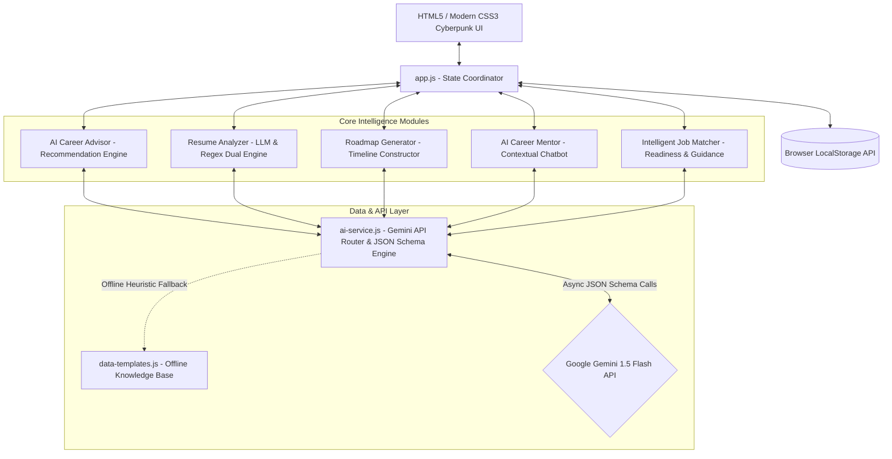

# GetCareerPilot – AI-Powered Career Guidance Platform | 2026 🚀
**AI Application Developer Project**

[](https://developer.mozilla.org/en-US/docs/Web/HTML)
[](https://developer.mozilla.org/en-US/docs/Web/CSS)
[](https://developer.mozilla.org/en-US/docs/Web/JavaScript)
[](https://ai.google.dev/)
[](https://opensource.org/licenses/MIT)

**GetCareerPilot** is an intelligent, client-side career guidance platform engineered to empower technology aspirants in navigating and mastering modern engineering careers. Built with a futuristic **Cyberpunk glassmorphic UI**, the platform seamlessly integrates **Google Gemini 1.5 Flash** to deliver personalized career recommendations, deep LLM-based resume skill-gap audits, customized 4-week learning curriculums, interactive mentorship, and intelligent job matching.

---

## 📌 Core Engineering Highlights

* **AI-Powered Career Guidance Platform:** Integrated Google Gemini API to dynamically analyze user educational background, engineering passions, and existing skills to synthesize tailored 2026 career recommendations with salary outlooks, growth projections, and match scores.
* **LLM-Based Features:** Implemented semantic resume skill-gap analysis, personalized 4-week learning roadmaps with daily milestones, and an interactive AI chatbot equipped with contextual engineering prompts.
* **Structured AI Response Generation:** Designed strict JSON schemas (`responseMimeType: "application/json"`) and asynchronous API integration ensuring error-free, type-safe client-side data parsing with intelligent offline heuristic fallbacks.
* **Intelligent Job-Matching Workflows:** Developed end-to-end job-matching workflows with multi-tier readiness scoring, requirement gap identification, and bespoke AI career guidance with tailored interview questions and STAR-method resume bullets.

---

## 🛠️ System Architecture

The application runs on a high-performance, serverless client-side architecture using modular ES6 JavaScript and browser `localStorage` persistence, connecting directly to Gemini API endpoints:



---

## 🌟 Key Features in Detail

### 1. 🧭 AI Career Advisor (Personalized Career Recommendations)
* **Tailored Recommendation Engine:** Users enter their academic background, current technical skills, engineering passions (e.g. Generative AI, Full-Stack, Cloud Systems), and work ambitions.
* **Gemini LLM Synthesis:** Evaluates 2026 technology trends to recommend the top 3-4 career tracks, complete with match percentages (e.g. 95%), market salary benchmarks, transferable strengths, skills to acquire, and immediate first steps.
* **1-Click Adoption:** Selecting any recommended career automatically configures the user profile and loads the Roadmap Builder.

### 2. 🔍 LLM-Based Resume Skill-Gap Analysis 🔥
* **Dual-Engine Architecture:** Toggle seamlessly between **Gemini LLM Semantic Mode** (deep context-aware analysis) and **Local Regex Matcher** (lightning-fast offline matching).
* **Semantic Evaluation:** Evaluates true engineering depth, architecture exposure, and production tooling beyond raw keyword matching.
* **AI Recruiter Verdict:** Synthesizes an executive assessment of candidate readiness.
* **Gap Remediation:** Categorizes missing technologies into *Critical*, *High*, and *Medium* priorities with practical mini-projects, and injects them as an extra week into the user's active roadmap with one click.
* **Tailored Resume Bullets:** Provides STAR-method bullet suggestions to upgrade the resume for that specific job posting.

### 3. 🗺️ Personalized Learning Roadmap Builder
* **Interactive 3-Step Wizard:** Customizes curriculums based on career track, experience level (Beginner/Intermediate/Advanced), and weekly bandwidth (5h - 40h/week).
* **Mastered Skill Filtering:** Detects existing skills and excludes or marks them as prerequisites in the syllabus.
* **Multi-Week Schedule & Projects:** Compiles 4 weeks of structured study topics, daily practical tasks, 3 progressive project specifications, and 5 technical interview questions.

### 4. 💬 Context-Aware AI Career Mentor Chat
* **Interactive Chat Companion:** Answers structural tech queries, system design principles, and code debugging.
* **Quick-Prompt Chips:** Instant prompts for project suggestions, interview tips, and learning roadmaps.
* **Markdown Code Rendering:** Formats code snippets, tables, and lists cleanly.

### 5. 💼 Intelligent Job-Matching & Career Guidance Workflow
* **Visual Workflow Pipeline:** Displays a 4-step pipeline: *Profile Extracted ➔ Compatibility Engine ➔ Gaps Identified ➔ AI Career Guidance*.
* **Dynamic Fit Quotients:** Computes real-time match scores against job openings using weighted intersections of verified skills and roadmap progress.
* **Bespoke Job Guidance Modal:** Users can click **"✨ AI Guidance"** on any job posting to receive:
  * Overall Candidate Assessment & Fit Quotient.
  * 7-Day Sprint Action Plan before applying.
  * Anticipated Interview Questions with specific coaching strategies.
  * Tailored STAR-method Resume Bullet Points with 1-click clipboard copy.

---

## 💻 Structured AI JSON Schema Implementation

All generative AI features strictly enforce structured JSON output using Gemini's `responseMimeType: "application/json"`, preventing markdown formatting errors and ensuring deterministic data types:

```javascript
// Example: Structured JSON Schema prompt in ai-service.js
const prompt = `You are an Elite AI Career Guidance Counselor & Technical Architect.
Analyze the user's background, current technical skills, and engineering passions...

You MUST return your response as a valid, parsable JSON object:
{
  "summary": "string (holistic assessment)",
  "recommendations": [
    {
      "id": "string",
      "title": "string",
      "matchScore": number,
      "badge": "string",
      "salaryRange": "string",
      "marketDemand": "string",
      "fitRationale": "string",
      "strengthsYouHave": ["string"],
      "skillsToAcquire": ["string"],
      "recommendedFirstStep": "string",
      "keyTechnologies": ["string"]
    }
  ]
}`;

const response = await fetch(`${this.getGeminiURL()}?key=${apiKey}`, {
  method: "POST",
  headers: { "Content-Type": "application/json" },
  body: JSON.stringify({
    contents: [{ parts: [{ text: prompt }] }],
    generationConfig: {
      responseMimeType: "application/json",
      temperature: 0.3
    }
  })
});
```

---

## 🚀 Getting Started

### 1. Prerequisites
GetCareerPilot is a 100% client-side application. No Node.js build steps, backend servers, or databases are required.

### 2. Launching Locally
* **Option 1: Direct Browser** — Double click `index.html` in Chrome, Edge, Safari, or Firefox.
* **Option 2: Local Web Server (Recommended)** — In the project root, run:
  ```powershell
  npx serve
  ```
  Or right-click `index.html` in VS Code and select **Open with Live Server**.

### 3. Activating Gemini Live AI Mode
1. Get a free API key from [Google AI Studio](https://aistudio.google.com/).
2. Open **GetCareerPilot** in your browser.
3. Navigate to **Settings ➔ Gemini AI Key**, paste your key, and click **Save Changes**.
4. All features (Career Recommendations, Skill Gap Analysis, Roadmaps, Job Guidance, and Mentor Chat) will instantly run on live Gemini 1.5 Flash AI!
5. *(Note: If no API key is provided, the platform automatically runs on our intelligent client-side heuristic engines for 100% offline functionality).*

---

## 📂 Project Directory Structure

```
GetCareerPilot/
│
├── index.html              # Single Page Application markup & cyber UI layouts
├── README.md               # Project documentation & portfolio highlights
│
├── css/
│   └── styles.css          # Glassmorphic cyber theme, design tokens, responsive layouts
│
└── js/
    ├── app.js              # Application state coordinator, tab routing, and event bindings
    ├── ai-service.js       # Google Gemini API connector, JSON schemas & offline heuristic engines
    ├── data-templates.js   # Predefined roadmaps, career archetypes, and mock job postings
    └── resume-analyzer.js  # NLP parser, regex extractor, and skill gap scoring algorithms
```

---

## 📄 License
This project is open-source and available under the [MIT License](LICENSE).
